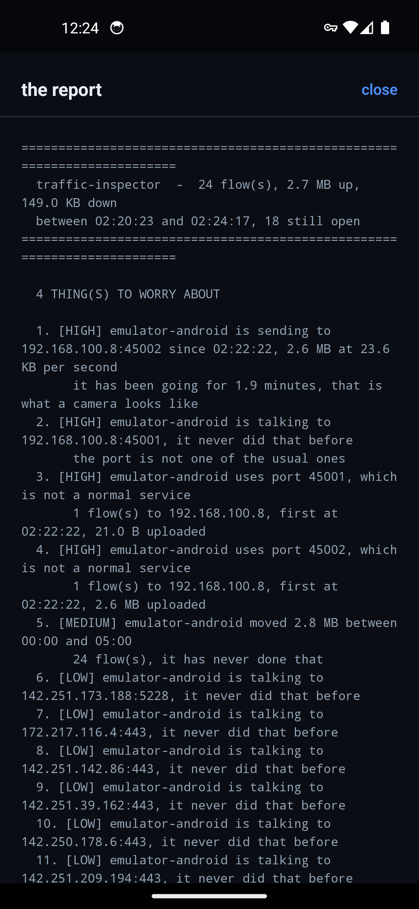

# traffic-inspector

A VPN server you run yourself, so you can see what a phone is really doing.

This project comes from a story I read on LinkedIn. A woman noticed that
her phone was always hot and that the battery was always dead, and she had
no idea why. She told a friend about it. The friend had a VPN server of his
own — running your own is common in Russia, he said — so he pointed her
phone at it and read the logs.

The logs showed her phone talking, in the middle of the night, to an address
she had never heard of, and sending a lot of data. Somebody had got hold of
that phone and was using its camera to film her.

The phone showed a green shield and nothing else. Her internet provider saw
encrypted traffic to a VPN server. The only place where the truth was
visible was the tunnel itself — and her friend was the one holding it.

**This project is that tool, made properly.** The phone sends all of its
traffic to your own server, your server writes down what it sees — which
destinations, which ports, how much, at what hour of the day — and then it
*judges* the traffic and tells you what is worth a look.

```
  the phone                    your pc                       the internet
 ┌───────────┐   encrypted    ┌──────────────┐              ┌───────────┐
 │  the app  │ ──── UDP ────▶ │  the server  │ ──────────▶ │  a host   │
 │  (vpn)    │   port 5555    │  the judge   │              │           │
 └───────────┘                └──────────────┘              └───────────┘
                                    │
                                    ├── traffic.csv      one row per flow
                                    ├── traffic-2026-10-21.csv   the history
                                    ├── reports/report-2026-10-22-0130.txt
                                    └── the terminal      what it sees, live
```

Nothing leaves your machine: the server is plain Python, it needs no root,
it changes no routes, it is not a router. It is a proxy that writes things
down.

The report, on the phone that asked for it:



---

## What you need

| | |
|---|---|
| **Python** | 3.8 or newer, nothing else — the standard library is enough |
| **A phone** | Android 7 or newer |
| **The Android SDK** | only for the emulator, not for a real phone |

The key between the phone and the server is created the first time the
server starts and is kept in `.env`. The phone needs the same key.

---

## The commands

### 1. Start the server

```bash
python tools/serve.py
```

It prints a card with everything the phone needs:

```
========================================================================
  THE SERVER IS RUNNING
========================================================================

  csv file      : /home/you/traffic-inspector/traffic.csv
  master key    : 6f2a9c1d8b3e4f7a0c5d2e8b1a4f6c9d3e7b0a5c2f8d1e4b7a0c3f6d9e2b5a8c1

  the phone has to reach this machine:
    on the same wifi : 192.168.100.8:5555

  [!] the firewall may block the port. As administrator run:
      netsh advfirewall firewall add rule name="traffic-inspector" dir=in action=allow protocol=UDP localport=5555
```

The server runs until you stop it with `ctrl+c`. Useful options:

```bash
python tools/serve.py --port 5556          # another port
python tools/serve.py --level quiet        # only the problems and the totals
python tools/serve.py --level verbose      # everything (the default)
python listeningServer.py --port 5555      # the plain server, without the card
```

### 2. Build the app

```bash
cd client/android/android
./gradlew assembleRelease          # on windows: gradlew.bat assembleRelease
```

The APK lands in `client/android/android/app/build/outputs/apk/release/app-release.apk`.

### 3. Put it on the phone

With a USB cable (turn on *developer options → USB debugging* on the phone
first):

```bash
adb install -r client/android/android/app/build/outputs/apk/release/app-release.apk
```

Or copy that file to the phone and open it there — Android asks whether
the app that opens it may install apps, say yes.

### 4. Point the phone at the server

Open the app and fill in four things:

| field | what to write |
|---|---|
| **server** | the address from the card, e.g. `192.168.100.8` |
| **port** | `5555` |
| **master key** | the key from the card |
| **name of the device** | anything you like, e.g. `pixel-8` — the report tells the devices apart by it |

Press **start the tunnel** and let the system ask for the permission for
the VPN (that is the one time you have to tap *OK*).

Two switches worth knowing:

- **connect when the phone starts** — the tunnel comes up by itself after a
  restart of the phone.
- **always-on VPN** in the settings of Android itself (Settings → VPN →
  Traffic Inspector) keeps the tunnel up even when the app is closed.

### 5. Watch

The phone's traffic now goes through your PC, and the terminal says what it
sees:

```
[+] Device connected: pixel-8 from 192.168.100.13:59070  (session 6652d6cfa56e9049)
[TUNNEL] pixel-8  10.8.0.1:58914 -> 142.251.157.119:443  (TCP/https)
[>] sent 517 B to 142.251.157.119:443  (517 B in total)
[<--] received 13.8 KB from 142.251.157.119:443  (13.8 KB in total)
[*] flow closed  pixel-8 -> 142.251.157.119:443  (up 517 B, down 13.8 KB, 2.1 s)
[*] 1 device(s), 32 flow(s), 22.3 KB up, 210.4 KB down
```

### 6. The report

Press **make the report** in the app. The phone asks the server for it
over the tunnel, the server makes it and sends it back, and the app shows
it. The same text comes out of the terminal:

```bash
python tools/analyze.py --csv traffic.csv --baseline auto
```

```
========================================================================
  traffic-inspector  -  39 flow(s), 2.4 MB up, 78.6 KB down
  between 00:01:18 and 23:59:32, 19 still open
========================================================================

  4 THING(S) TO WORRY ABOUT

  1. [HIGH] emulator-android is sending to 192.168.100.8:45002 since 00:01:31, 2.4 MB at 23.6 KB per second
       it has been going for 1.7 minutes, that is what a camera looks like
  2. [HIGH] emulator-android is talking to 192.168.100.8:45001, it never did that before
       the port is not one of the usual ones
  3. [HIGH] emulator-android uses port 45001, which is not a normal service
       1 flow(s) to 192.168.100.8, first at 00:01:21, 21.0 B uploaded
  4. [MEDIUM] emulator-android moved 2.4 MB between 00:00 and 05:00
       3 flow(s), it has never done that
```

Every report is also kept in the **`reports` folder**, with the time in the
name: `reports/report-2026-10-22-0130.txt`.

---

## Without a phone: the emulator

One command brings up the server, the emulator, installs the app, fills in
the settings and starts the tunnel:

```bash
python tools/serve.py --emulator
```

It needs the Android SDK (`ANDROID_SDK_ROOT`, or the default location of
the SDK) and an AVD called `ti-test`. The tools live in the
`cmdline-tools` folder of the SDK:

```bash
sdkmanager "system-images;android-34;google_apis;x86_64" "platforms;android-34" \
           "emulator" "platform-tools"
avdmanager create avd -n ti-test -k "system-images;android-34;google_apis;x86_64"
```

The emulator reaches your computer at `10.0.2.2`, and the script uses that
address by itself.

---

## The report

The report leads with a verdict — *N THING(S) TO WORRY ABOUT* — and then
the findings, the devices, the destinations, the ports and the hours of the
day. It looks for:

| | |
|---|---|
| **a stream** | an upload with a steady rate that never stops — the rate is what tells a camera apart from a page that loads |
| **the quiet hours** | what happened between 00:00 and 05:00, and whether it is more than the device has ever done |
| **a new destination** | a host that was not in the file of yesterday |
| **an odd port** | a port that is not a normal service for a phone |
| **a talker** | a device that suddenly opened many more connections than before |

Two rules keep it from crying wolf:

- a device that was not there yesterday is **new**, and it is marked as
  such — everything it does is new too, so that is not reported. The report
  only complains about what a device does that it did *not* do before.
- the ports a phone really uses (the push of Google on 5228, the STUN of
  the calls) are not odd.

The report also works as a cron job: it exits with **1** when something is
worth a look, so it can send you a mail.

```bash
python tools/analyze.py --csv traffic.csv --baseline auto || mail -s "traffic" me@example.com
```

---

## The CSV

One row per flow, rewritten about once a second, so it is always current
and you can read it while the server runs:

```
flow_id,ts_start,ts_end,time_of_day,duration_s,client_id,device,
tunnel_src,tunnel_src_port,src_ip,src_port,dst_ip,dst_port,dst_name,
proto,service,bytes_up,bytes_down,state,note
```

| column | what it is |
|---|---|
| `time_of_day` | the local `HH:MM:SS` — the column that makes *"it happened at 2am"* answerable |
| `device` | the name the phone gave itself, so the devices can be told apart |
| `src_ip` / `tunnel_src` | the address the destination saw, and the address of the phone |
| `bytes_up` / `bytes_down` | the direction matters: a webcam stream is a sustained *upload* |
| `state` | `active`, `closed` or `error` — the file shows the live flows too |
| `note` | why a flow was closed, when there is a reason |

---

## The history

The server keeps one file per day. `traffic.csv` is the current one, and
when the day changes it is kept as `traffic-2026-10-21.csv` and a new one
is started. That history is what makes *"it never did that before"*
possible — `--baseline auto` finds the archive of yesterday by itself.

The rows also survive a restart of the server, so the day stays whole.

---

## The tests

```bash
python -m pytest tests -q                  # 81 tests
cd client/android/android && ./gradlew testReleaseUnitTest   # 15 tests
cd client/android && npx jest              # the screen renders
```

---

## The repository

```
traffic-inspector/
├── server/            the server
│   ├── server.py        the tunnel: sessions, frames, the loop
│   ├── proxy.py         the flow table, the TCP proxy, the UDP relay
│   ├── protocol.py      the frames on the wire
│   ├── crypto.py        AES-256-GCM, HKDF, the handshake
│   ├── inspector.py     the CSV
│   ├── report.py        the judgement, the verdict
│   └── log.py           the terminal
├── client/            the clients
│   ├── main.py          the command line client (Linux and Windows)
│   ├── tun_linux.py     the TUN device of Linux
│   ├── tun_windows.py   the Wintun adapter of Windows
│   ├── tunnel.py        the client side of the protocol
│   ├── bridge.py        the TCP state machine
│   ├── socks.py         a SOCKS5 proxy, for a browser
│   └── android/         the app: React Native in front, Kotlin behind
├── tools/
│   ├── serve.py         the server and the card
│   ├── analyze.py       the report on the command line
│   ├── DEPLOY.md        how to put the server on the internet
│   └── VM_SETUP.md      how to try the Linux client in a virtual machine
├── tests/
├── docs/               the pictures of the readme
├── testing.py          a stub client, it fills the CSV with real rows
├── PROTOCOL.md         the wire format
├── LICENSE
└── README.md
```

---

## If something goes wrong

| what you see | what it means |
|---|---|
| the phone never connects | the port is blocked: run the `netsh` line from the card as administrator, and check that the phone is on the same wifi |
| `authentication failed` | the key is not the same on both sides — the phone has the key of another server |
| the app says *the system did not allow the tunnel* | the permission of the VPN was taken away (that happens when the app is installed again) — open the app and say yes once more |
| the tunnel is up but nothing arrives | the phone has no route into the tunnel: turn the VPN off and on again in the settings of Android |
| the video of the phone does not play | the app is too old: the datagram of the phone was broken before, build it again and install it |

---

## How it works

The client terminates the TCP connection for the kernel of the phone and
proxies it to the server, which terminates it for the destination. Only the
payload crosses the tunnel, the sequence numbers never do. The frames are
sealed with AES-256-GCM, the key of a session is derived with HKDF from a
handshake that proves both sides know the master key.

The wire format is in **[PROTOCOL.md](PROTOCOL.md)**.
